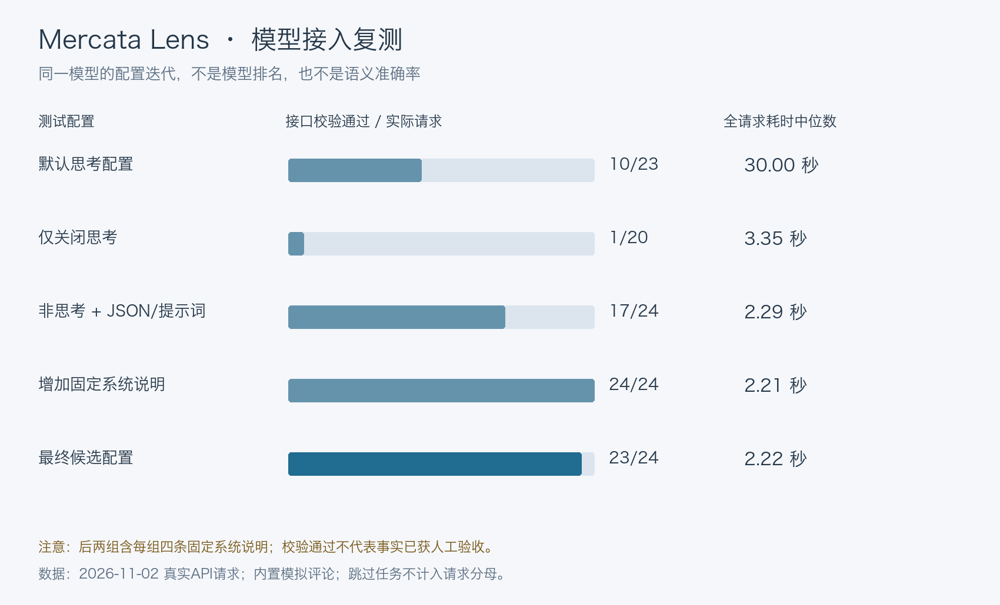
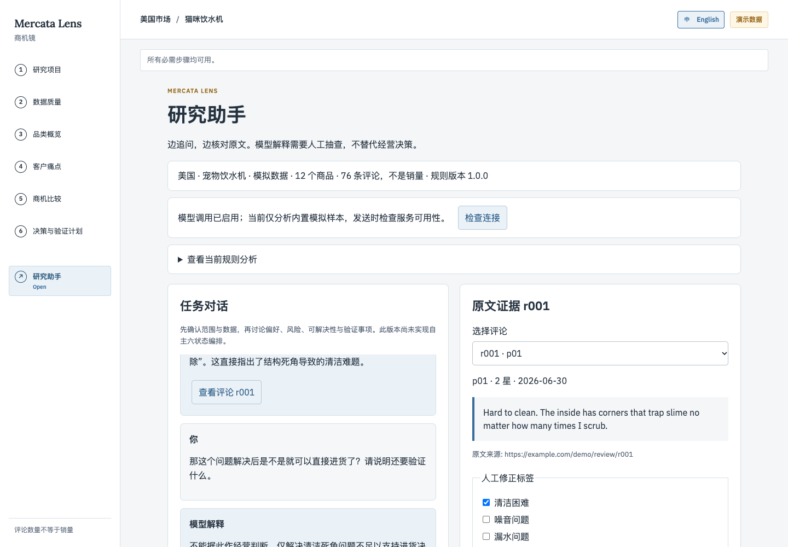

# Mercata Lens 模型接入与小样本测试报告
日期：2026年11月2日。项目：商机镜；方向：智能体与大模型应用。

## 结论
建议将 **qwen3.7-plus 的非思考配置保留为受控演示候选**。最终完整复测实际请求24次，23次通过接口校验，两组均完成连续三轮；额外通过真实浏览器完成“前端—本地服务—百炼”的三轮链路。成功接入不代表语义验收全部通过，不能宣称已找到最优模型或产品达到无人审核使用条件。
已保留原有六步规则分析、证据查看和标签修正功能。新增的是模型适配和系统说明的内部契约，不替换确定性统计。仅使用内置模拟数据，不发送用户上传评论。

## 测试目的和授权边界
验证普通评论问答能否在可接受响应时间内给出有依据的解释、维持上下文，并拒绝编造和经营预测。不是复现综合能力榜单，不评价数学、代码、通用智能或真实选品收益。
用户费用约束为“只用免费额度，用完即停”。用户确认目标模型有额度并已开启服务端开关；密钥保存在本机被Git忽略的配置。未核对控制台账单，因此费用不能标为已核实零元。未购买套餐、充值或进行付费回退。
当前只测试了阿里云百炼北京接口下的qwen3.7-plus；其他候选是否有额度尚未确认，不能形成跨模型排名。

## 数据、用例与方法
数据为项目内置12个商品、76条合成演示评论，不是真实消费者调研或Amazon采集。任务共12类，每组计划重复两遍，覆盖清洁、否定语境、漏水的证据局限、不同产品声音对比、水泵故障与安全风险、销量/采购边界、伪造评论、来源说明、连续三轮和错误人工标签。
按程序结构校验、有效引用ID、辅助语义审阅分别记录结果。expectedIds和rubric是本次评测工作依据，尚非独立人工金标；未完成原50条评论人工审核。没有随机化或统计显著性检验。
每组复测保留原始失败，不自动重试。第一组有前置轮次失败后的跳过，分母按实际请求统计。迭代中提示词、参数及契约均有变化，因此这是工程适配记录，不是严格控制变量的模型优劣实验。

## 配置迭代结果
| 配置 | 实际请求 | 接口校验通过 | 全请求耗时中位数 |
| --- | ---: | ---: | ---: |
| 默认思考配置 | 23 | 10 | 30.00 秒 |
| 仅关闭思考 | 20 | 1 | 3.35 秒 |
| 非思考 + JSON/提示词 | 24 | 17 | 2.29 秒 |
| 增加固定系统说明 | 24 | 24 | 2.21 秒 |
| 最终候选配置 | 24 | 23 | 2.22 秒 |

后两组各包含四条由服务端替换的固定系统说明；不能把它们算作模型自由回答质量通过。最终组的分析回答为20次，其中19次通过校验；来源/经营边界说明4次均按固定文案返回。
最终组所有24次请求耗时范围为1.23～3.63秒，中位数2.22秒；此处为完整非流式API往返耗时，包含服务处理和网络，非首字延迟。当前未加入并发/长时间稳定性测试。耗时不等于纯推理能力；后续部分请求命中输入缓存，结果不能直接外推。
这五个完整批次合计115次请求；另有初始非思考探针及诊断2次、适配探针1次、真实浏览器3次，共121次实际外部请求。中间的本地HTTP fixture不是模型请求，未计入。

## 根因与完成的修改
默认思考响应包含较多推理token，且在现有30秒阈值下多次超时。显式关闭思考后变快，但暴露了编号和引用契约问题。
- 新增显式MODEL_PROFILE=qwen-json-nonthinking，仅允许已核对的百炼北京HTTPS接口和Qwen模型。通用配置保持原行为。
- 该配置发送enable_thinking=false、response_format=json_object、max_completion_tokens=1024。JSON模式只约束语法，不证明事实正确。
- 强化正文与引用字段的区别、事实与假设的区别，提示不捏造批次、材质、事故和经营数据。
- 数据来源与无法预测经营结果改为两种固定系统说明。服务端忽略模型在这类分支的自由文案，前端只接受共享固定文字、空引用并标记“系统范围说明”。分析分支仍必须有有效评论引用，且原数字/编号限制保留。
- 评测逐条保存进度、记录提示词SHA256与配置、保存受限诊断字段；HTTP拒绝立即停止，不读取或保留错误正文。用量只保存有限非负整数白名单，避免上游任意元数据落盘。

官方参数语义说明：max_tokens对Qwen不包含思维链，max_completion_tokens限制推理和回答总量，不能将首轮总输出超过max_tokens直接认定为供应商错误。来源：[官方接口参数](https://help.aliyun.com/zh/model-studio/qwen-api-via-openai-chat-completions)、[思考模式说明](https://help.aliyun.com/zh/model-studio/deep-thinking)。

## 语义辅助审阅与遗留问题
最终组23条可展示结果中：4条是固定系统说明；19条是模型分析。辅助审阅对其中15条未发现关键方向性错误，4条需继续人工复核，另有1条因编号被拦截。这些是逐条工作记录，不是模型准确率或独立人工验收。
- 正向结果：识别“没有电机噪音”为安静反馈；区分水泵停转与已证实电气安全事故；拒绝伪造评论和热卖保证；识别人工噪音标签与清洁原文不一致。
- 三轮结果：两组均维持清洁评论上下文，第二轮提供英文原句，第三轮保留经营判断边界。
- 需复核的四条：T03两次、T04第一遍、T11第二遍补充其他样本反馈，却未列全对应引用。仅增加提示词约束未彻底解决该问题，不能写成已修复。后续宜使用确定性证据选择/逐事实引用，再用独立人工审核核对。
- 被拦截的一条：T04第二遍正文包含评论编号，触发原有校验。失败正确留在报告中，没有以放宽校验换取通过。
- 真实浏览器第二轮将英文原文译述成中文并加引号，应标为译述而非英文原文的逐字引文；右侧原文可直接核对。该现象说明用户仍需人工抽查。

## 真实浏览器链路验证
使用本机研究助手页面，未使用transport stub，真实请求经过前端、Vite代理、本地Node接口和百炼。三轮耗时分别为2.225、2.139、2.339秒；请求历史长度为0、2、4，版本标识一致，引用均指向r001，并成功打开原文。

该截图来自真实调用后的界面，不是生成的产品效果图。仍为本地Demo，没有部署或真实市场效果证据。

## 工程验证与复核
- Vitest：37个文件、302项通过。
- Node服务端与评测脚本：13项通过；包括未知profile禁用、原有数字/引用拒绝、固定说明白名单、401/429后停止和逐条落盘。
- 构建成功；Playwright完整回归7项通过，涵盖原有工作流、导入错误、三轮测试替身、布局和系统说明。
- 独立代码复核：APPROVED；只针对代码和回归边界，不代表真实模型语义已获验收。
本轮仅本地运行；没有推送或部署。免费额度是供应商侧保护，脚本标志和调用上限不是账单硬保证。

## 后续验收清单
- [x] 本地真实API接入及三轮链路记录。
- [x] 延迟、结构通过、失败与语义问题分开记录。
- [x] 产品原有功能回归及密钥边界检查。
- [ ] 确定性约束指定评论的输入范围，并实现逐事实引用，解决剩余引用链问题。
- [ ] 完成独立人工审阅与原50条评论审核，不以模型自评替代。
- [ ] 待账号确有其他候选免费额度，再用同一协议做横向模型对比。
- [ ] 对照教案补齐设计反馈、说明书/代码注释等尚未核实的材料；“继续往下做”仅按教师原反馈记录，不等同最终验收通过。

## 复现入口
运行配置见.env.example；密钥只填本地.env.local。先运行node scripts/benchmark-agent.mjs做零调用预检。确认免费额度及供应商用完即停生效后，采用profile配置运行真实测试；不要把密钥写入报告或聊天。
最终完整数据：results/2026-11-02T11-40-41.087Z.json；辅助审阅：results/2026-11-02-final-assisted-review.json；真实浏览器记录：results/2026-11-02-live-browser.json。完整迭代批次均保留，不能只展示最好的一组。
