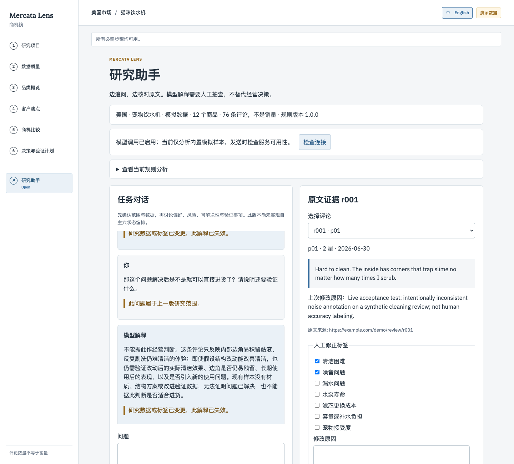

# Mercata Lens · DeepSeek本地演示验收与默认模型记录
日期：2026年11月3日；起始HEAD：b41a600。

## 验收决定
**已将本机演示环境的默认模型设为deepseek-v4.1-flash**，使用bailian-json-nonthinking配置；qwen3.7-plus保留为手动备选，不启用自动回退。原有六步规则分析、证据面板和标签纠错功能未变。无本地密钥或未显式启用时仍保持规则分析降级。
决定依据是本轮完整模拟任务与真实页面链路通过，不是生产上线结论，也不代表独立人工语义审核完成。配置只写入本机被Git忽略的.env.local，没有将密钥提交或部署。

## 完整12类任务结果
每类重复两遍，共24次真实请求，24次均通过当前接口校验，无跳过、无自动重试。20条为带有效引用的模型分析，4条为服务端固定的来源/经营边界说明；固定说明不能计为模型自由回答正确。

| 指标 | 实测结果 |
| --- | --- |
| 实际API请求 | 24 |
| 接口校验通过 | 24 |
| 模型分析 / 固定系统说明 | 20 / 4 |
| 完整响应耗时中位数 | 1.21秒 |
| 完整响应最小～最大 | 0.767～2.123秒 |
| 批次返回usage合计 | 34,164 Token |
| 连续三轮 | 两组完成，引用r001，历史0/2/4 |

覆盖清洁问题、否定语境、漏水局限、多产品声音对比、故障与安全、销量采购拒绝、伪造评论拒绝、来源说明、连续三轮、错误人工标签与新版本。
辅助逐条审阅未观察到关键方向性错误：未把安静评价反读为投诉、未把停机说成触电事故、未伪造评论或热卖保证，错误噪音标签未冒充清洁原文。英文原句可核对，中文译述与假设有明确区分。此结果只针对本批样本；humanReview保持PENDING，不写成100%准确率。

## 真实页面验收
本机页面经过Vite代理、本地gateway与百炼完成6次真实调用，另有1次本地注入502并在浏览器直接返回，注入请求没有外发。
- 三轮真实对话：约1.616、1.268、1.392秒；请求历史长度0、2、4；同一研究版本。
- 点击引用：打开r001原文并转移焦点。
- 标签纠错：必须填写原因才能应用；故意给清洁评论增加噪音标签作为测试，六条旧消息均标失效。
- 纠错后提问：新revision、空历史、包含测试注释；模型指出原文不支持噪音，未把标签当作市场事实。
- 异常恢复：仅注入一次本地502，草稿保留，点击Retry后真实调用成功。不能把这项模拟写成实际供应商宕机或真实超时测试。
- 来源问答：返回固定系统说明，明确模拟样本不代表真实市场。

截图来自本轮真实页面，展示的是纠错失效状态；完整步骤以browser JSON为准。截图保存时发现file URL空格编码路径问题，已将唯一生成文件迁移到正确仓库并修复脚本为fileURLToPath；路径修复后未再次完整跑6次，未冒充新的模型验证。
浏览器记录的model字段是预期配置，不是独立供应商快照探测。本轮gateway由显式DeepSeek环境变量启动；API批次另有请求与返回模型元数据。不能据浏览器文字声称已验证某个独立版本快照。

## 本地默认与备选操作
当前本机配置已读回核对：MODEL_NAME=deepseek-v4.1-flash、MODEL_PROFILE=bailian-json-nonthinking、MODEL_CALLS_ENABLED=true，Key存在但未显示。现运行gateway也是显式DeepSeek配置。
需要手动回到Plus时，在本地.env.local将MODEL_NAME改为qwen3.7-plus，保留同一共享profile，确认其免费额度与用完即停后重启`npm run agent:server`。不得把Key复制到聊天或文档。没有自动模型回退，也没有开启付费。
新环境仍先参考.env.example，未配置不调用；当前默认选择是本机配置，不是发布到其他用户的全局产品默认。

## 工程检查
- Node服务端与评测脚本：18项通过。
- Vitest：37个文件、302项通过。
- 构建成功。
- Playwright完整回归：7项通过，覆盖原有规则流程、导入错误、未配置模式、对话测试替身、布局与系统说明。这些自动回归与上面的真实页面6次调用分开计。
- 新增可复现脚本scripts/verify-agent-live.mjs；无显式live及free-only标志时立即退出，未启动浏览器或调用模型。脚本只访问localhost、不读取API Key，最多6次gateway真实请求。
- 独立只读代码复核：APPROVED。复核涵盖调用计数、故障注入、记录支持程度和语法边界，不替代独立人工业务审核。
本轮没有新增产品代码，没有推送或部署。改动为验证脚本、说明、原始记录、截图和验收材料。

## 数据、费用与验收范围
本轮仅内置12商品76评论的合成演示数据。完整API批次24次加页面6次，共30次真实请求；注入故障1次不外发。API批次返回34,164Token，浏览器6次未保存供应商usage，因此不提供虚构的整体精确Token总量或实时余额。
继续使用用户已确认的免费额度及用完即停；未充值、购买或故意转付费，控制台账单未核对，不能宣称已独立证实零元。
未完成：独立人工50条审核、真实消费者数据验证、长时间/并发稳定性、真实供应商故障恢复、教案其他设计材料的最终审核。此版本仍没有自主六状态编排，不将问答成功等同完整自主Agent。

## 原始记录与复现
- 完整任务：results/2026-11-03T06-28-56.619Z.json
- 辅助审阅：results/2026-11-03-deepseek-full-assisted-review.json
- 真实页面：results/deepseek-browser-2026-11-03T06-30-22.003Z.json
- 计划：docs/superpowers/plans/2026-11-03-deepseek-acceptance.md

`node scripts/benchmark-agent.mjs`为零调用预检；真实批次须原live/free-only标志及本机密钥后运行`--live`。真实浏览器验收须先在localhost启动期望模型gateway与前端，再显式设置BENCH_LIVE_APPROVED=true、BENCH_FREE_ONLY_CONFIRMED=true运行`node scripts/verify-agent-live.mjs`。这是会消耗额度的真实操作，不列入默认自动测试。
