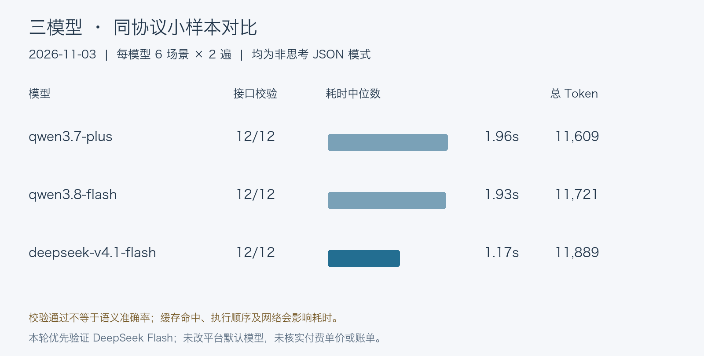

# Mercata Lens 三模型小样本对比报告
日期：2026年11月3日；当前产品方向：面向美国宠物饮水机的可追溯评论洞察。

## 结论与选择
本轮建议优先将 **deepseek-v4.1-flash 作为下一阶段演示验证候选**。三个模型在相同6类场景各测试两遍，都完成12次请求并通过接口校验；DeepSeek本次响应中位数最低，且辅助审阅中能较清楚区分英文原句、译述、不同商品以及证据不足。
这是当前小批数据内的选择依据，不是通用能力排名、统计显著结论或生产质量证明。平台默认模型仍保持qwen3.7-plus，本轮没有静默切换。两个Flash尚未覆盖数据来源固定说明、错误人工标签、伪造评论指令等完整原12类任务，因此还不能直接宣称完整替换验收完成。

## 费用与数据授权
用户截图显示qwen3.8-flash、deepseek-v4.1-flash分别有1M免费额度，并确认两个“用完即停”已打开；Plus有此前确认的余量。本轮只执行免费额度条件下的测试，不充值、不购买、不关闭保护、不付费回退。
共36次真实请求，供应商usage合计 **35,219 Token**。输入缓存可能影响计量和账单；控制台余量和实际费用未查询，因此不将返回usage等同实际收费，不声称已核实零元。更没有以不同模型Token数量直接推出谁的付费费用最低。
所有请求只发送项目内置模拟评论，没有真实市场数据或用户上传内容。原始总数据为12商品76评论，具体问题只发送明确指定的评论子集。

## 公平比较协议
- 同一百炼北京兼容接口、同一已有本地Key、同一修复后的证据选择及历史分段代码。
- 使用显式共享配置bailian-json-nonthinking，仅允许本次三个候选；同样的system prompt，SHA256：df9f90ee35b9ea58b1b56c2e3c9159f3b7d02dc04b4d47c92a312877fb1f4838。
- enable_thinking=false、response_format=json_object、max_completion_tokens=1024、temperature=0、30秒超时，均未按某个新模型单独调优。相同输入任务与证据范围，后续对话会自然携带各自前轮回答。
- 场景为T03漏水边界、T04正反声音、T05故障与安全、T09/T10/T11连续三轮。每模型两遍，最多12次；三批顺序执行，不自动重试，任何HTTP拒绝立即停止对应批次。
- 顺序为Plus→Qwen Flash→DeepSeek Flash，未随机化，未控制服务器负载及缓存条件。原提示词经过Plus适配，可能存在提示词开发偏向。比较反映当前产品接入协议，不代表各模型经过独立最优调参后的上限。
- 题目已在早先迭代使用，不是隐藏测试集；样本量小，只能提供方向性选型证据。

## 结果
| 模型 | 校验通过/请求 | 全请求中位耗时 | 最小～最大耗时 | 返回总Token | 返回缓存Token |
| --- | ---: | ---: | ---: | ---: | ---: |
| qwen3.7-plus | 12/12 | 1.96 秒 | 1.26～4.46 秒 | 11,609 | 5,120 |
| qwen3.8-flash | 12/12 | 1.93 秒 | 1.15～3.50 秒 | 11,721 | 0 |
| deepseek-v4.1-flash | 12/12 | 1.17 秒 | 0.97～4.18 秒 | 11,889 | 8,448 |

这里的耗时为非流式完整响应往返，不是首字延迟。三个模型均有较慢的单次响应，不能只用中位数承诺每次都在该时间内返回。Token为供应商口径，模型之间分词规则可能不同。

## 证据与连续对话核对
程序记录确认三个模型的全部36次请求中，输入ID都符合任务范围：T03仅r027、T04仅r016与r018、T05仅r030、三轮均为r001。返回ID未缺失预期引用。上一轮T10“不要切换到其他评论”意外扩大全量的问题，在这次真实调用中没有重现。
三个模型各完成两组三轮，发送历史长度均为0、2、4。每个模型的两次T10都包含与r001原文一致的完整英文句子，未切换评论；各次T11都保留了经营判断边界，没有据此给出进货结论。
这些检查证明范围及引用标识正确，并不自动证明回答中的每个事实被原文蕴含。

## 逐条语义辅助审阅
本次由Codex将36条回答与已提供原文对照，不是独立人工金标，humanReview保持PENDING。
- 三个模型都将短期未漏水视为局限体验，未声称永不漏水；识别声音正反证据，未泛化为全部很吵；未从水泵停转推出已发生触电。
- Plus回答较简洁，两遍漏水中有一遍将中文译述置于“原文中的”引号内，翻译标记仍可改进。
- Qwen Flash解释较完整，其中一遍漏水将中文翻译称为原文，标记仍可改进。其两次原文追问均准确给出英文原句。
- DeepSeek在本批中较主动标明英文原句与译述，并在声音对比中区分不同产品。给出的放置稳定性、结构改动或卫生风险均保留为假设、风险线索或待验证项；不能写成已发生事故或已验证改进效果。
- 本批未发现把未提供的其他评论具体体验写成当前证据的情况。这只是这36条回答的观察，不代表已经消除所有幻觉或引用问题。

## 工程改动与验证
最小增加共享profile白名单，并让评测脚本的参数冲突检查识别此profile。复用原有非思考JSON配置和所有提示词，不放宽数字、经营边界、引用及证据范围校验。原qwen profile及generic模式保持兼容，.env.local与产品默认模型未修改。
Node测试先观察新增跨三模型配置断言失败，再实现适配；最终服务端及评测脚本 **18项通过**。Vitest **37文件302项通过**，构建成功。独立代码复核结论 **APPROVED**，仅针对代码和回归，不替代真实语义人工验收。前端本轮未改，不把旧浏览器截图写成本轮真实页面验证。
起始HEAD：bc87340；不推送、不部署。具体文件：server/agent.mjs、server/agent.test.mjs、scripts/benchmark-support.mjs、.env.example，以及计划、评测原始记录、审阅与报告配图。

## 接下来的验证门槛
DeepSeek优先进入完整原12类用例和真实页面验证，重点检查伪造指令、错误标签、数据来源以及纠错版本失效。需要采用同样硬校验和独立人工审阅；在此前只视为优先候选。此报告没有把尚未执行的验证计作完成。
目前没有必要更换账号或额外充值。若之后额度耗尽，停止对应模型，不自动转付费。

## 原始材料与复现
三模型原始记录分别为：
- results/2026-11-03T05-38-22.286Z.json
- results/2026-11-03T05-38-57.589Z.json
- results/2026-11-03T05-39-51.947Z.json
汇总：results/2026-11-03-three-model-summary.json；辅助审阅：results/2026-11-03-three-model-assisted-review.json。旧批次保留，不拿昨天的配置结果直接替代今天基线。
先执行`node scripts/benchmark-agent.mjs --evidence-six`做零调用预检。真实测试在确认免费额度与用完即停后，通过进程环境设置MODEL_PROFILE=bailian-json-nonthinking、MODEL_NAME为对应模型，并使用原授权标志执行`--live --evidence-six`，不要把Key写到聊天、报告或版本库。
官方参数参考（2026年11月3日核实）：[百炼DeepSeek接口](https://help.aliyun.com/zh/model-studio/deepseek-api)、[百炼兼容接口参数](https://help.aliyun.com/zh/model-studio/qwen-api-via-openai-chat-completions)。这里采用百炼的enable_thinking，不混用DeepSeek直连接口的thinking参数。
