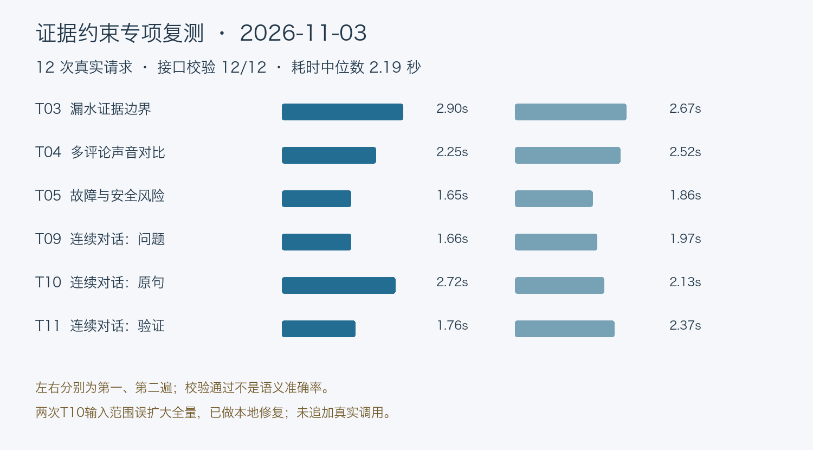

# Mercata Lens 证据约束专项复测报告
日期：2026年11月3日；模型：qwen3.7-plus；显式配置：qwen-json-nonthinking。

## 本轮结论
完成6个场景、每场景两遍，共12次真实调用，无自动重试。12次均通过现有接口校验，两组都完成连续三轮，耗时中位数 **2.19秒**（范围1.648～2.896秒）。辅助核对未发现上一轮那种把其他评论中的具体体验当作当前评论证据的回答，但这不是独立人工验收或准确率。
实际输入记录还发现一项范围识别缺陷，两次追问发送了全量评论；已用本地回归修复，最后修复没有再次真实调用。因此不能宣称所有请求均已严格限制到指定评论。

## 授权和数据
用户截图确认免费额度剩余511.91K Token并授权自主执行。本轮仍只用免费额度、保留用完即停，不充值。本轮供应商返回usage合计 **17,724 Token**，没有usage缺失的请求；控制台可能存在更新延迟或其他调用，不能据此宣称实时余额。用量不等于已核实账单。
输入仅使用项目内置模拟评论，原始样本仍为12商品、76评论。没有上传用户数据、采集真实市场数据、推送或部署。与11月2日的模型接入报告是递进关系，不替代旧失败记录。

## 修改了什么
此前仅用提示词约束，模型仍可看到整批原文，存在混用事实的机会。本轮新增确定性证据选择：
- 识别问题中明确出现的有效评论ID，只发送对应原文与该范围的标签注释。
- 对限定模式的追问，从最近用户问题延续明确评论范围；切换到不同ID时移除不相关旧历史。
- 明确全局问题保持全量；未识别到明确范围的一般问题保持原有全量功能。不是对任意自然语言查询的完整语义解析。
- 返回引用必须属于本次实际提供的证据。评论编号仍不能夹在正文中，统计和采购边界未放宽。
- 评测记录新增实际输入评论ID和发送历史长度，可检查“传了什么”，不再只看“回答引用了什么”。
引用ID存在及范围正确不等于每个事实被原文支持，仍需要逐条原文核对。

## 六类测试结果
| 场景 | 实际请求 | 接口结果 | 证据核对 |
| --- | ---: | --- | --- |
| T03 漏水证据边界 | 2 | 2次通过 | 均未将短期未漏水变成永久保证；第一遍译述标记不够清楚 |
| T04 声音正反对比 | 2 | 2次通过 | 输入和返回引用均包含r016、r018，未泛化为全部很吵 |
| T05 故障与安全风险 | 2 | 2次通过 | 未从水泵停机断言触电事故 |
| T09 三轮起点 | 2 | 2次通过 | 聚焦r001清洁问题 |
| T10 原文依据追问 | 2 | 2次通过 | 英文整句与原文一致，中文标译述；输入范围缺陷见下 |
| T11 验证事项追问 | 2 | 2次通过 | 延续r001，不输出进货结论，验证项保留不确定性 |

T09/T10/T11构成两组三轮；本次记录的发送历史长度分别为0、2、4，引用维持r001。没有真实浏览器额外请求，本轮直接通过产品runModel路径测试；11月2日已单独记录真实浏览器三轮，不把二者混淆。

## 发现并修复的输入范围缺陷
T10的原问题为“刚才说的那个问题，原文是什么依据？不要切换到其他评论。”程序错误地将“其他评论”识别为切换全局，因此本批两次T10实际发送了76条评论，而非只发r001。回答恰好保持正确，不能因此忽略程序缺陷。
处理：补上该精确否定语句的回归测试，确认先失败；移除过宽的全局关键词后测试通过。最终代码在本地测试中只提供r001并保持追问上下文。此外，独立复核复现了历史回扫跨过全局/新主题的情况：切回某评论时携入旧全局回答，或新主题追问继承更早的评论范围。已补失败回归，再改为按连续对话段正向计算范围，新主题作为历史边界，17项本地回归通过。为遵守本轮最多12次真实调用的计划，上述最终修复均未增加云端复测。
因此，本批已实测的10条输入收窄请求与两条意外全量请求必须分开看；不能将12/12接口校验写成12/12范围隔离实测成功。

## 仍保留的限制
- T03第一遍把中文“目前为止”称为原文，是英文so far的译述，宜明确标为翻译。T10两次则都提供了准确英文原句。
- 范围识别基于明确ID与有限追问/全局模式，不覆盖所有中英文表达、否定或复杂集合操作；不能称为完整检索系统。
- 程序阻止超范围引用，但尚未自动验证所有自然语言事实的蕴含关系；模型即使只看到一条原文也可能臆测。
- 仅12次同类小样本，不能宣布泛化可靠性、生产可用率或模型最优；本轮未增加其他模型。

## 工程验证
Node服务端与评测回归17项通过（包含明确范围、超范围引用拒绝、追问延续、全局保留及否定语句）；Vitest37文件302项通过；构建成功。前端未改动，本轮不重复记录旧浏览器截图为新成果。独立代码复核结论为APPROVED，复核者独立执行Node测试17/17通过；只针对代码边界，不代表最终修复已再次云端验证。

## 复现与材料
零调用检查：`node scripts/benchmark-agent.mjs --evidence-six`，应报告6场景、每场景2遍、12次计划、externalCalls为0。
真实运行仍须本地密钥、MODEL_CALLS_ENABLED=true、MODEL_PROFILE=qwen-json-nonthinking、BENCH_LIVE_APPROVED=true及BENCH_FREE_ONLY_CONFIRMED=true，再运行同脚本的`--live --evidence-six`。这些标志不是账单保护，供应商免费额度用完即停仍需有效。
原始记录：results/2026-11-03T04-00-58.981Z.json；辅助审阅：results/2026-11-03-evidence-six-assisted-review.json。humanReview保持PENDING，本报告的语义核对来自Codex辅助，未替代独立人工审核。

## 工程交付记录
起始HEAD：a556a5e。实现文件：server/agent.mjs、server/agent.test.mjs、scripts/benchmark-agent.mjs；其他为计划、评测原始数据、辅助审阅、报告、配图和任务记录。前端未改。
验证命令：`node --test server/agent.test.mjs scripts/benchmark-agent.test.mjs`（17通过）；`npm test -- --reporter=dot`（37文件302通过）；`npm run build`（成功）。本轮不部署、不推送；密钥配置保持Git忽略。
