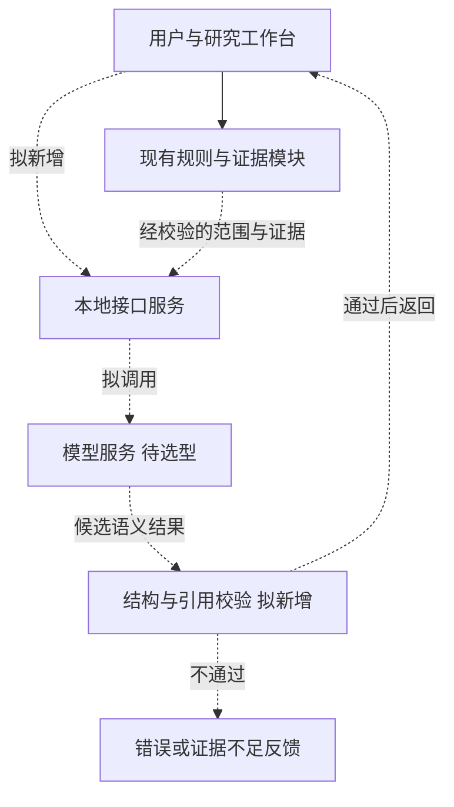

# Mercata Lens 工程架构与环境记录
日期：2026年11月2日
适用方向：智能界面—智能体与大模型应用
状态：现有工程记录已整理；新增模型架构为方案，尚未实现。

## 1 现有工程与目录
项目根目录：`/Users/xanthe/Documents/Mercata Lens`。
现有应用为 React、TypeScript 与 Vite 构建的本地前端，使用 Papa Parse 读取CSV，使用 React Router 组织六个研究页面。当前没有模型服务、登录或云数据库，研究数据保存在浏览器当前会话中。

| 目录 | 现有职责 |
|---|---|
| src/app | 应用入口、路由和样式 |
| src/pages | 首页、数据质量、类目概览、评论痛点、机会比较、判断与验证计划 |
| src/components | 证据查看、纠错、权重及验证计划等交互组件 |
| src/data | 演示数据与CSV导入、研究数据导出 |
| src/domain | 数据契约、质量检查、规则及计算逻辑 |
| src/research | 研究状态与布局 |
| src/fixtures | 测试用固定样本 |
| public/demo | 模拟商品与评论CSV |
| e2e | 浏览器端到端测试文件 |
| docs | 设计、实施计划与验证材料 |
| workbuddy/tasks | 既有分任务说明 |

## 2 后续架构方案

实线表示现有模块关系，虚线表示拟新增能力。模型不能修改原始评论、生成统计分母或绕过证据检查。正式实现应冻结每次请求的数据范围和规则版本；研究数据被替换后，旧会话结果应标为失效或重新确认。
本地接口服务负责密钥读取、请求校验、会话上下文、模型适配及返回检查。模型只负责语义分析、解释与追问。计数、筛选与索引继续使用确定性程序。未配置模型时明确显示规则模式，不生成假模型结果。

## 3 环境记录
| 项目 | 当前记录 |
|---|---|
| 核验日期 | 2026年11月2日 |
| 本次命令环境Node.js | v24.18.0，由 node --version 确认 |
| 本次命令环境npm | 11.16.0，由 npm --version 确认 |
| 项目声明的包管理器 | pnpm@11.19.0，来自package.json；本次未验证其可用性 |
| 启动命令 | pnpm dev，来自项目脚本与README，本次未启动 |
| 单元测试命令 | pnpm test |
| 构建命令 | pnpm build |
| 浏览器测试 | 已有e2e文件与Playwright配置，执行参数需结合配置核对 |
| 开发服务端口 | PORT环境变量或5173，来自vite.config.ts；可被命令行覆盖 |
| 模型环境与密钥 | 未配置；不在本文记录密钥 |

package.json中的依赖范围不是已安装版本证明，安装版本应以锁文件和实际运行结果为准。最近一次本聊天核验记录为2026年10月30日：35个测试文件、294项测试通过，构建通过；本次未重跑，不能写成11月2日测试结果。
现有Vite配置监听0.0.0.0并允许所有Host。后续引入密钥与本地接口时需重新审查访问范围，默认限制到本机，并检查接口请求来源；当前无密钥不能证明后续配置安全。

## 4 文件与交付规范
沿用现有代码分层，不为满足目录示例而移动整个项目。新文档使用日期与主题命名，代码沿用现有命名风格；使用Git记录版本，每次提交写清范围与验证。输出清单包括可运行原型、流程图、设计稿、代码册和测试记录。注释率≥30%是教案要求，计量范围与统计方式须在代码册中明确，目前未核验。

## 5 待确认
模型供应商、具体模型、费用上限、实际调用环境与数据发送范围均未确定。用户当前选择先整理方案与材料，不注册账号、不产生模型费用。模型接入前补充技术选型、接口契约与实施计划，并标明历史设计中禁止模型的条款已由2026年11月2日AGENTS.md范围调整取代，其他边界继续有效。
